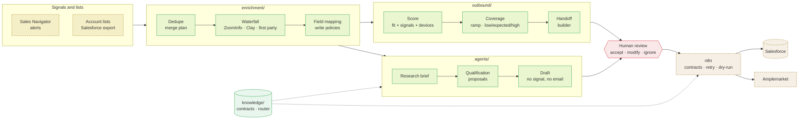

# emnify GTM Toolkit

**An outbound engine and enrichment layer for consumption-based IoT connectivity.** A working prototype built against the emnify GTM Engineer posting: how I would enrich accounts, prioritize outbound, forecast usage-based pipeline, and put Claude agents behind a human-review gate.


> Everything about emnify here is a **hypothesis: validate**. I have no access to emnify's systems or data. Stack facts come from the posting, vertical facts from the public website, and every working assumption is labelled. Data is synthetic, nothing calls an external service, and no credentials are present.

<!-- BEGIN company:role -->
emnify GTM Engineer (Senior (IC4), Sales Operations), reports to the Revenue Operations Lead, works with the CRO. Job 5004134101, posted 2026-10-13.
<!-- END company:role -->

---

## How it fits together



Green nodes run offline in this repo. Dashed amber nodes are specs or stubs that need credentials. Nothing is written to Salesforce or sent to a prospect without the red human-review gate.

## What is here

| Folder | Posting area | Real, offline | Stub or spec |
|---|---|---|---|
| [`enrichment/`](enrichment/README.md) | Lead enrichment end to end | Waterfall rules engine (no `eval`), dedupe, field-mapping contract | Salesforce and ZoomInfo clients, Clay table spec |
| [`outbound/`](outbound/README.md) | Pipeline coverage via outbound | Account scoring, consumption coverage model, handoff builder | Amplemarket push |
| [`agents/`](agents/README.md) | AI agents with Claude and Clay | Prompts, offline workflows, 9 eval cases incl. prompt injection, review gate | Live model mode |
| [`integrations/`](integrations/README.md) | Integration layer | Data contracts, retry and dead-letter, importable n8n workflows | Amplemarket, Attention, Weflow, Clay clients |
| [`knowledge/`](knowledge/README.md) | Machine-readable company knowledge | Workflow contracts, validator, index, router lookup | n/a |
| [`ROADMAP.md`](ROADMAP.md) · [`DECISIONS.md`](DECISIONS.md) · [`ICP.md`](ICP.md) | First six months, judgment, ICP | Documents | n/a |

## Start here

| If you want | Read |
|---|---|
| The posting mapped to files | [`ROLE_MAP.md`](ROLE_MAP.md) |
| A ten-minute talk track for one account | [`docs/WALKTHROUGH.md`](docs/WALKTHROUGH.md) |
| What the code actually prints | [`docs/examples/emnify-sample-runs.md`](docs/examples/emnify-sample-runs.md) |
| What I would ask the team first | [`QUESTIONS.md`](QUESTIONS.md) |

## Why consumption revenue changes the model

A usage contract signs before it earns. Counting signed value as pipeline overstates a period, because devices go live over months and not all reach expected usage. So [`outbound/coverage.py`](outbound/coverage.py) converts each opportunity into the revenue it can realize inside the period (ramp, realization, win rate), reports **low / expected / high**, and prints its assumptions. [`DECISIONS.md`](DECISIONS.md) explains this and eight other choices, plus six illustrative push-backs.

## Stack named in the posting

<!-- BEGIN company:stack -->
| Need | Tool | Source | State |
|---|---|---|---|
| crm | Salesforce | jd | hypothesis: validate (system of record) |
| enrichment orchestration | Clay | jd | hypothesis: validate (must-have: walk through a flow) |
| data provider | ZoomInfo | jd | hypothesis: validate (licensed seats, credit model) |
| sequencer | Amplemarket | jd | hypothesis: validate (outbound engagement layer) |
| workflow automation | n8n | jd | hypothesis: validate (self-hosted vs cloud) |
| conversation intelligence | Attention | jd | hypothesis: validate (call data source) |
| salesforce sync | Weflow | jd | hypothesis: validate (activity and meeting capture into SFDC) |
| social selling | LinkedIn Sales Navigator | jd | hypothesis: validate |
| llm | Claude | jd | hypothesis: validate (API access and data-handling terms) |
<!-- END company:stack -->

## My results this is based on

From a previous role, mine and confirmed, not emnify's:

<!-- BEGIN company:proof -->
- Signal-based prospecting with Clay sourced about 80% of pipeline (Certa, confirmed)
- Deal-risk and pipeline-health scoring moved win rate from about 10% to about 15% (Certa, confirmed)
- Speed-to-lead went from 30 minutes to 5 minutes (Certa, confirmed)
- Security questionnaire and RFP turnaround went from 1.5-3 weeks to under 2 days, with human review kept (Certa, confirmed)
<!-- END company:proof -->

I have not claimed these for emnify and do not assume they transfer.

**What may carry over:** the method. Source from signals before lists, calibrate scoring to the win rate you actually have, instrument speed to lead, and keep a person on anything automated that touches a customer or a record. **What does not:** any number. That work was on a different product with contract-priced deals, and emnify's revenue is usage-based, so the coverage and forecast logic here is new and untested.

## Run it

```bash
pip install -r requirements.txt
python -m enrichment.run --dry-run     # dedupe plan, waterfall, mapping, dry-run upsert
python -m outbound.run --dry-run       # ranking, held handoff, coverage cases
python -m agents.run_evals             # 9 eval cases across 3 agents
python -m knowledge.tools validate     # schema, staleness, router targets
python -m outbound.sensitivity         # how ramp and realization move coverage
python -m pytest                       # 134 tests
```

## Single source of values

[`company.yaml`](company.yaml) holds the role, stack, ICP hypotheses, regions and guardrails, each tagged `jd`, `public`, `hypothesis` or `confirmed`. `python scripts/render_company_docs.py` regenerates the marked blocks in the docs from it, and `--check` runs in CI so docs cannot drift.

## Inherited from the template

`shared_core/`, `gtm_engineer/` and `gtm_strategy_ops/` come from my GTM and RevOps template and run on synthetic data configured by [`config/company.yaml`](config/company.yaml), which holds generic example segments, not emnify's. See [`docs/REPO_MAP.md`](docs/REPO_MAP.md). `make data demo test` still works. Decision 7 in [`DECISIONS.md`](DECISIONS.md) explains the two config files.

## Not here, on purpose

- No live runs in Clay, Salesforce, ZoomInfo, Amplemarket, Attention or Weflow.
- No emnify data, contacts or internal information.
- No performance claims for the models in this repo. Coverage and scoring numbers are placeholders that show the arithmetic.
