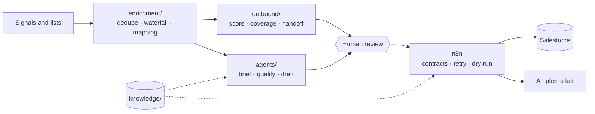

# Architecture

## Principles

1. **Dry-run first.** Every write path defaults to a plan, not an action. Live mode is a stub that needs credentials.
2. **One gate.** Sends, CRM writes and disqualification always go to a person who accepts, modifies or ignores.
3. **Rules are data.** Waterfall conditions are structured YAML evaluated without `eval`.
4. **Inbound is data.** Call summaries, replies and scraped text never choose a tool or a write.
5. **One source of values.** `company.yaml` feeds code and docs; a CI check stops drift.

## Real versus stub

Real and offline: waterfall engine, dedupe, field mapping, scoring, coverage model, handoff builder, agent workflows and evals, contract checker, retry, knowledge tools, n8n JSON. Stub or spec: Salesforce, ZoomInfo, Amplemarket, Attention, Weflow and Clay clients, and the Clay table.
